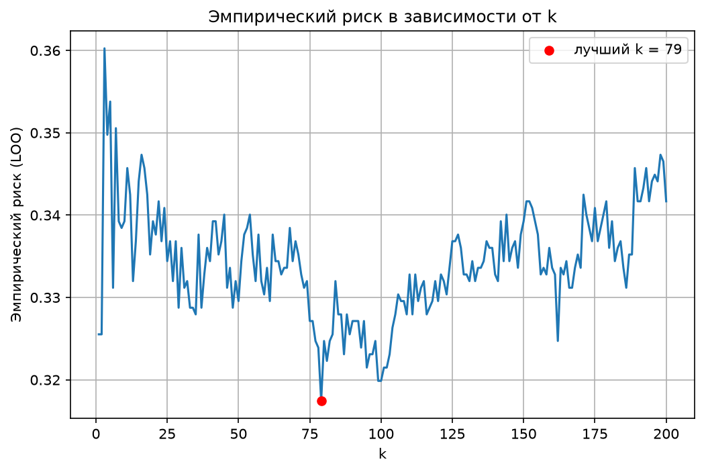
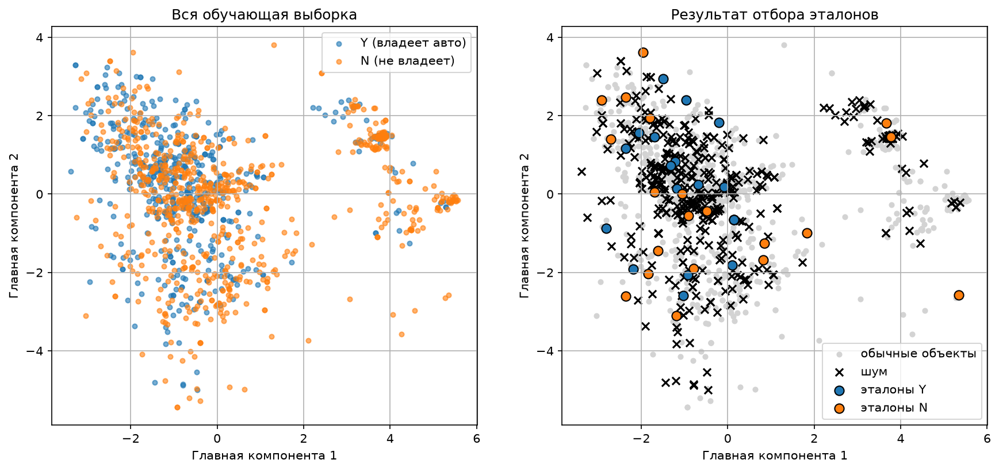
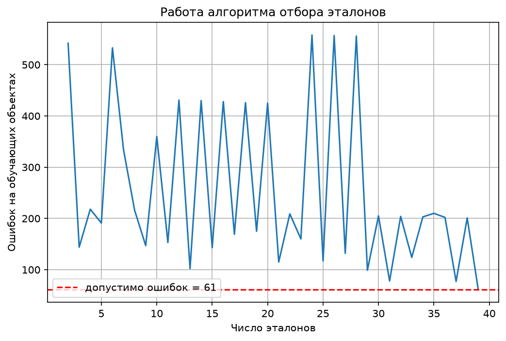

# Лабораторная работа №2. Метрическая классификация

## Данные

Взят датасет Credit Card Approval (Kaggle, rikdifos), читается по ссылке с GitHub (`DATA_URL` в начале файла). Целевой признак - `Car_Owner`, в выборке 1548 объектов: 924 класса N и 624 класса Y. Данные сразу делятся на обучающую (1238) и тестовую (310) части со стратификацией, и только после этого заполняются пропуски (медиана, мода и «Unknown» считаются по train), кодируются категории и выполняется стандартизация. Стандартизация нужна, потому что KNN работает с расстояниями: без неё признак «годовой доход» полностью заглушил бы все остальные. Классы кодируются как +1 (Y) и −1 (N). После кодировки получается 45 признаков.

## Алгоритм

Реализован KNN с окном Парзена переменной ширины (класс `ParzenKNN`). Для классифицируемого объекта находятся его k ближайших соседей по евклидову расстоянию, а ширина окна h берётся равной расстоянию до (k+1)-го соседа, то есть она своя для каждого объекта. Вес соседа считается гауссовым ядром от отношения расстояния к ширине окна, K(r) = exp(−r²/2), где r = d/h. Веса соседей суммируются по классам, побеждает класс с большей суммой (при равенстве берётся более частый класс обучающей выборки).

## Подбор k методом LOO

Для каждого объекта обучающей выборки считается, как его классифицирует алгоритм, обученный на всех остальных объектах (сам объект исключается из соседей). Доля ошибок и есть эмпирический риск скользящего контроля. Он посчитан для k от 1 до 200, график ниже показан для всего диапазона.

Минимальный риск 0.3174 достигается при k = 79, при k = 1 он равен 0.3255. Для сравнения, классификатор, всегда отвечающий «N», ошибался бы в 40.3% случаев. Выигрыш от соседей есть, но небольшой: по признакам из анкеты наличие автомобиля предсказывается плохо. Кривая шумная, разница между соседними значениями k составляет около одного процента (это 10–15 объектов), так что выбор k = 79 опирается на минимум на графике, а не на сильное преимущество. Расстояние, ядро и способ выбора ширины окна фиксированы по заданию, подбирался только k, причём исключительно по обучающей выборке: тест в выборе k не участвовал.

## Сравнение со sklearn

Сравнение на тестовой выборке при k = 79. Строка «веса Парзена» - это `KNeighborsClassifier` с собственной функцией весов (берутся k+1 соседей, у последнего вес 0, он нужен только для ширины окна); она проверяет, что наша реализация считает то же самое.

| Модель | Accuracy | Precision | Recall | F1 |
|---|---|---|---|---|
| KNN + окно Парзена (наш) | 0.6839 | 0.6800 | 0.4080 | 0.5100 |
| sklearn KNN (обычный) | 0.6742 | 0.6622 | 0.3920 | 0.4925 |
| sklearn KNN (веса Парзена) | 0.6839 | 0.6800 | 0.4080 | 0.5100 |

Предсказания нашей реализации совпали с sklearn с весами Парзена на всех 310 объектах. С обычным KNN (равные веса) совпадение 99.0%, различаются три объекта из 310, что и даёт разницу в accuracy 0.6839 против 0.6742. Такая разница лежит в пределах шума.

## Отбор эталонов

Использован алгоритм STOLP. Отступом объекта считается (вес своего класса − вес чужого) / (сумма весов), он лежит в диапазоне от −1 до 1 и считается тем же окном Парзена; отрицательный отступ означает, что объект на обучении классифицируется неверно. Алгоритм работает так: сначала по отступам относительно всей выборки (с исключением самого объекта) выбрасывается шум, то есть объекты с отступом меньше δ; затем в эталоны берутся по одному самому «уверенному» объекту каждого класса; потом в цикле оставшиеся объекты классифицируются только по эталонам, и пока число ошибок больше допустимого, в эталоны добавляется ошибочный объект с наименьшим отступом.

Параметры: δ = 0, то есть шумом считаются объекты, которые соседи классифицируют неверно (393 из 1238), допустимое число ошибок - 5% обучающей выборки (61 объект). При δ = −0.4 шумом признаётся лишь 69 объектов, но тогда требуемая точность на обучении достигается только при 609 эталонах, и accuracy на тесте падает до 0.603, поэтому выбран δ = 0. Для k в классификаторе на эталонах берётся то же k = 79; если эталонов меньше 80, используется k = (число эталонов − 1). Именно из-за этого график ошибок во время отбора «пилообразный»: при малом числе эталонов k меняется на каждом шаге.

На картинке выборка спроецирована на две главные компоненты (метод PCA), поэтому классы выглядят перемешанными: двух компонент недостаточно, чтобы их разделить, это ограничение самой проекции.

Результат: из 1238 обучающих объектов оставлено 39 эталонов (3.2%), 19 класса Y и 20 класса N.

| Модель | Объектов в обучении | Accuracy | Precision | Recall | F1 |
|---|---|---|---|---|---|
| KNN без отбора эталонов | 1238 | 0.6839 | 0.6800 | 0.4080 | 0.5100 |
| KNN с отбором эталонов | 39 | 0.6839 | 0.6311 | 0.5200 | 0.5702 |

## Выводы

Собственная реализация KNN с окном Парзена переменной ширины полностью совпадает с sklearn при тех же весах, оптимальное k по LOO равно 79. Отбор эталонов сократил обучающую выборку в 32 раза (с 1238 до 39 объектов) без потери accuracy на тесте: precision снизилась, recall выросла, F1 стала выше